# Travel Memory — AWS Deployment Report

**Assignment 2 · Aditya Verma · 25 October 2026**

**Application:** [https://travel.iadityalabs.xyz](https://travel.iadityalabs.xyz)
**Source repository:** [i-adityaverma/TravelMemory](https://github.com/i-adityaverma/TravelMemory)
**Region:** Asia Pacific (Mumbai), `ap-south-1`
**Status:** Final draft for review. Results below are supported by supplied screenshots and terminal output. Remaining verification and submission actions are listed at the end.

## 1. Objective and result

The assignment required deploying the Travel Memory MERN application on EC2, connecting the React frontend to the Node.js backend through Nginx, running multiple application instances behind a load balancer, and connecting a Cloudflare-managed domain.

Two Ubuntu EC2 instances now serve the React frontend and Express backend in different Availability Zones. An internet-facing Application Load Balancer (ALB) forwards requests to Nginx on each instance. Both backends use the same MongoDB Atlas database. Cloudflare DNS maps the application hostname to the ALB, and an Amazon-issued certificate enables HTTPS at the ALB.

Backend reads, a browser trip submission, two healthy ALB targets, and custom-domain application access were demonstrated. The user subsequently stopped one VM: intermittent HTTP 504 responses occurred initially, then the application served successfully without configuration changes after a waiting period. This demonstrates user-observed eventual failover, with a detection-period interruption.

| Requirement | Implementation | Evidence |
| --- | --- | --- |
| Backend on port 3000 with Nginx | Express on 3000; Nginx proxies `/api/` | Screenshots 06–08 |
| Frontend/backend communication | React build uses `REACT_APP_BACKEND_URL=/api` | Build output; screenshots 08–09 |
| Multiple frontend and backend instances | Each EC2 instance runs both tiers | Screenshots 14–17 |
| Load balancing | ALB with two healthy targets across two AZs | Screenshots 16–17 |
| Cloudflare CNAME and A records | `travel` to ALB; `direct` to EC2 public IP | Screenshot 18 |
| Custom-domain HTTPS | ACM certificate and ALB HTTPS listener | Screenshots 20–23 |
| Documentation and architecture | This report and editable draw.io diagram | Linked below |
| GitHub submission | Repository identified; final artifacts still need committing and pushing | Final checklist |

## 2. Deployment architecture

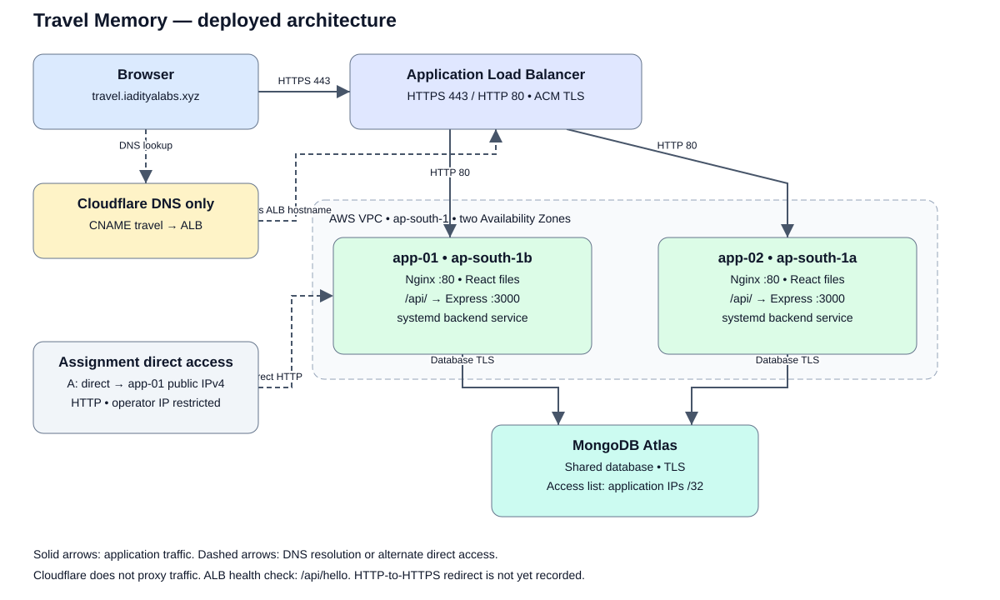

**Editable diagram:** [architecture.drawio](architecture.drawio). Open this file in draw.io / diagrams.net to edit or export it.

Cloudflare uses **DNS only**: it resolves the hostname; application traffic goes directly from the browser to the ALB. HTTPS terminates at the ALB on port 443. The ALB forwards HTTP to Nginx on port 80. Nginx serves compiled React files and forwards `/api/` requests to Express on local port 3000. Express reads and writes the shared Atlas database.

Both application tiers are duplicated across the EC2 instances. The health-check path `/api/hello` checks Nginx and Express HTTP serving, not Atlas connectivity. No Auto Scaling group was configured.

| Resource | Recorded configuration |
| --- | --- |
| VPC | `vpc-079b7559ae745d27c`, `172.31.0.0/16` |
| App-01 | `travelmemory-app-01`, `i-0bb42ccb08216995a`, t2.micro, ap-south-1b |
| App-01 subnet | `subnet-032a4790e0b3eb7b6`, `172.31.0.0/20` |
| App-02 | `travelmemory-app-02`, `i-0afa200d1889b3b7a`, t2.micro, ap-south-1a |
| App-02 subnet | `subnet-0ca5bb0c2fbe159fa`, `172.31.32.0/20` |
| Private application AMI | `travelmemory-app-v1`, `ami-0c38399d79f98b7e9` |
| ALB | `travelmemory-alb`, Internet-facing, IPv4 |
| ALB DNS | `travelmemory-alb-1786523090.ap-south-1.elb.amazonaws.com` |
| Target group | `travelmemory-app-tg`, Instances, HTTP:80, HTTP/1.1 |
| Certificate | ACM public RSA 2048, export disabled, `travel.iadityalabs.xyz` |
| Certificate ID | `fb6bbe18-edc0-47e4-a8a3-94c1583dc289` |

Public EC2 addresses changed during stop/start cycles. Screenshot addresses describe capture time. Consult the EC2 console before configuring SSH, Atlas access, or the direct DNS record.

## 3. Prepare the first EC2 instance

The instance used Ubuntu 24.04.5 LTS on x86_64, 952 MiB RAM, no swap, and a 6.8 GB root filesystem. At inspection, 3.7 GB disk space was available. Nginx was active; the initial runtime was Node.js 18.19.1 with npm 9.2.0.

The installed system packages were `nginx`, `git`, `curl`, and `ca-certificates`. Inspection commands:

```bash
cat /etc/os-release
uname -m
free -h
df -h /
node --version
npm --version
systemctl is-active nginx
```

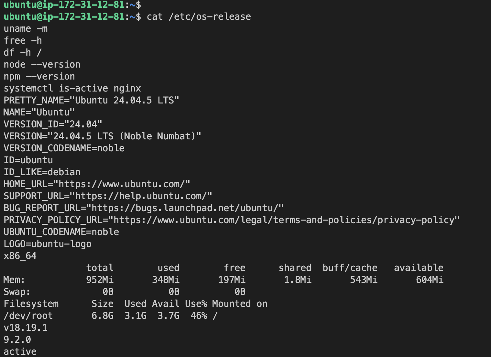

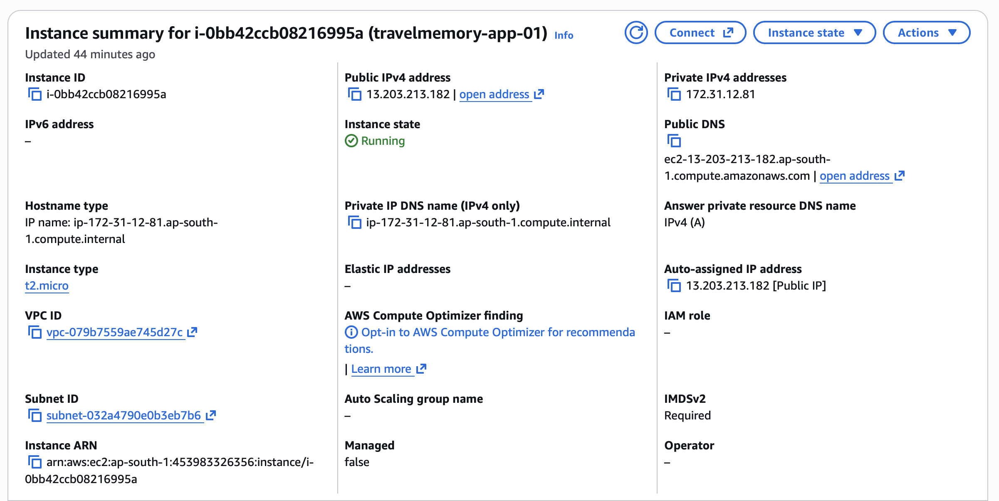

The instance security group, `launch-wizard-5`, initially allowed SSH on TCP/22 and HTTP on TCP/80 from the operator's IPv4 /32. An ALB source-group rule was added later.

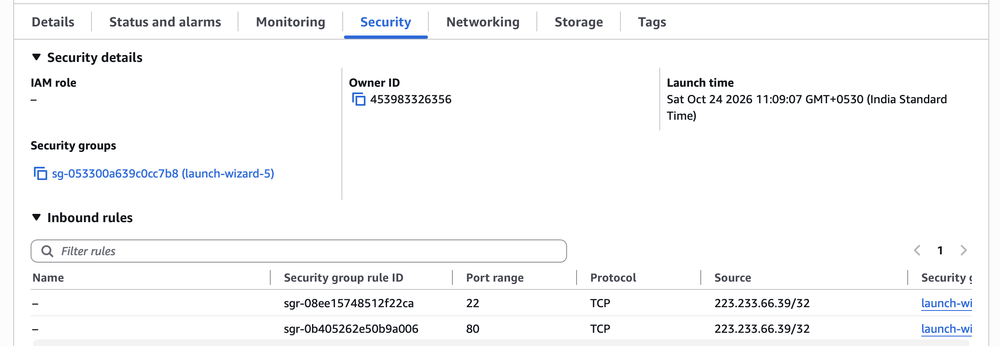

The [full initial console capture](screenshots/05-ec2-overview-full.png) is also retained.

## 4. Clone the application and install Node.js

The upstream application was cloned into the Ubuntu user's home directory:

```bash
cd ~
git clone https://github.com/UnpredictablePrashant/TravelMemory.git
```

Node.js 22 was installed with nvm. The recorded deployment runtime is **Node.js v22.23.4**, **npm 10.9.9**.

```bash
curl -fsSL https://raw.githubusercontent.com/nvm-sh/nvm/v0.40.8/install.sh -o /tmp/install-nvm.sh
bash /tmp/install-nvm.sh
export NVM_DIR="$HOME/.nvm"
. "$NVM_DIR/nvm.sh"
nvm install 22
nvm alias default 22

cd ~/TravelMemory/backend
npm ci
```

Backend dependencies were installed from the lockfile. The service below uses this Node version's absolute path; update it if the runtime changes. Reference: [nvm installation](https://github.com/nvm-sh/nvm#installing-and-updating).

## 5. Configure Atlas and the backend

An existing free MongoDB Atlas database was used. Each application instance's public outbound IP was allowed as a /32 entry in Atlas Network Access. The initial screenshot shows a historical address.

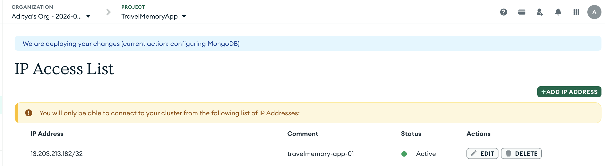

The backend `.env` has the following structure. Credentials are excluded from the report:

```dotenv
MONGO_URI="<ATLAS_CONNECTION_STRING>"
PORT=3000
```

Preserve the database selection in the working URI: changing the database name changes which records the application reads.

```bash
cd ~/TravelMemory/backend
chmod 600 .env
node index.js
```

From another SSH session:

```bash
curl -i --max-time 15 http://127.0.0.1:3000/hello
curl -i --max-time 15 http://127.0.0.1:3000/trip
```

Both returned HTTP 200. The first returned `Hello World!`; the second returned persisted JSON records. Initial testing used 3001, then the backend was switched to **3000** to meet the assignment.

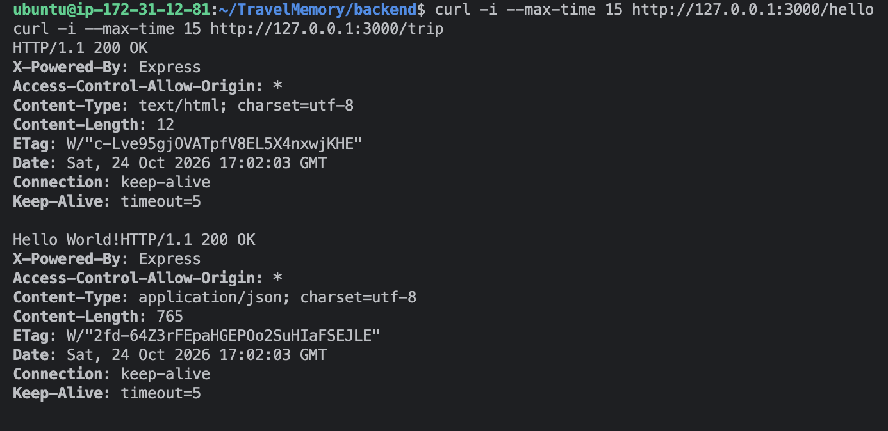

## 6. Start the backend automatically with systemd

Service definition: [travelmemory-backend.service](../deploy/travelmemory-backend.service).

The unit runs as `ubuntu`, uses the backend working directory so dotenv loads `.env`, starts on boot, and restarts after process failure. It references the nvm-installed Node binary directly because systemd does not load the interactive shell's nvm setup.

Install the supplied unit as `/etc/systemd/system/travelmemory-backend.service`. Stop the manually running backend to free port 3000, then run:

```bash
sudo systemctl daemon-reload
sudo systemctl enable --now travelmemory-backend
sudo systemctl status travelmemory-backend --no-pager
curl -i --max-time 15 http://127.0.0.1:3000/trip
```

The service was **enabled** and **active (running)**, and the API read succeeded.

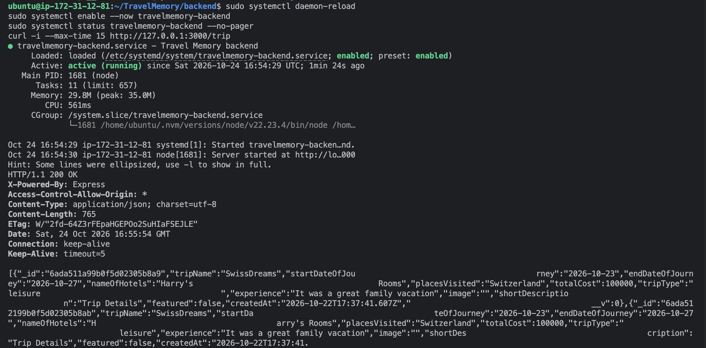

## 7. Build and connect the frontend

The actual configuration file is `frontend/src/url.js`, although the assignment calls it `urls.js`. Its existing environment-variable support was used to configure the API URL at build time:

```bash
cd ~/TravelMemory/frontend
printf 'REACT_APP_BACKEND_URL=/api\n' > .env.production
npm ci
GENERATE_SOURCEMAP=false npm run build
test -f build/index.html && echo "Frontend build ready"
```

The build completed with warnings. Source maps were disabled to reduce resource usage. The relative API URL makes requests use the same hostname as the frontend, supporting direct instance, ALB, and custom-domain access.

## 8. Configure Nginx

Nginx serves the build from `/var/www/travelmemory`:

```bash
sudo mkdir -p /var/www/travelmemory
sudo cp -r ~/TravelMemory/frontend/build/. /var/www/travelmemory/
```

Install [travelmemory.nginx.conf](../deploy/travelmemory.nginx.conf) at `/etc/nginx/sites-available/travelmemory`. Its API location proxies to `http://127.0.0.1:3000/`. The trailing slash strips the `/api/` prefix, so `/api/trip` reaches Express at `/trip`. React routes fall back to `index.html`; missing static assets return 404. Reference: [Nginx proxy_pass](https://nginx.org/en/docs/http/ngx_http_proxy_module.html#proxy_pass).

Initial site activation and checks:

```bash
sudo unlink /etc/nginx/sites-enabled/default
sudo ln -s /etc/nginx/sites-available/travelmemory /etc/nginx/sites-enabled/travelmemory
sudo nginx -t
sudo systemctl reload nginx

curl -I http://127.0.0.1/
curl -i --max-time 15 http://127.0.0.1/api/hello
curl -i --max-time 15 http://127.0.0.1/api/trip
```

The symlink commands describe initial setup; do not repeat them if already configured. Nginx validation passed and the proxied API returned records. An initial transient 404 was followed by a successful check of the same URL; its cause was not established.

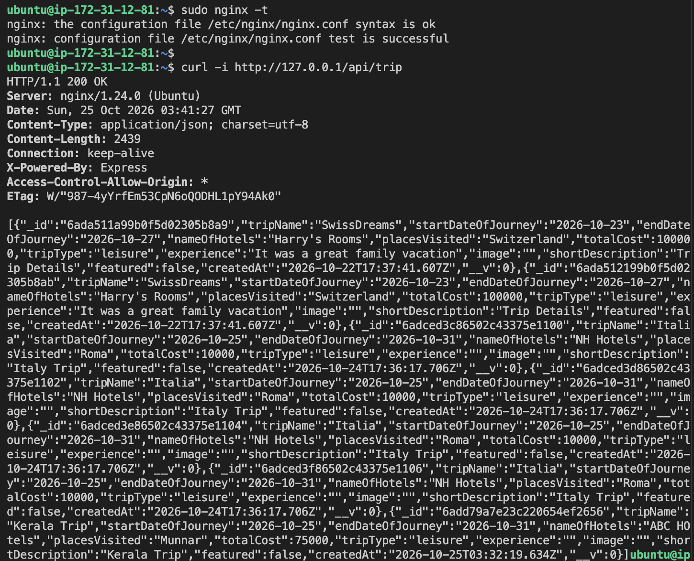

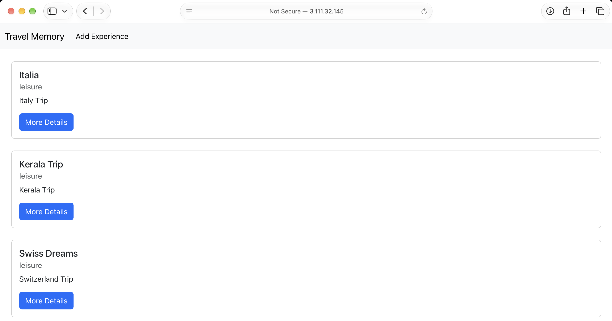

## 9. Verify form submission

A save initially failed because `shortDescription` was empty. The schema requires a trip name, both journey dates, and a short description. After filling Short Description, the user confirmed the trip saved; the new Kerala record appears in the API and browser evidence.

No application source-code changes are required for this deployment. The frontend and backend source files are retained unchanged from the original application. Runtime and build configuration are supplied through the backend environment file, frontend production environment variable, Nginx site configuration, and systemd service. Suggested form-feedback, validation, and error-handler edits from troubleshooting are not part of the submitted implementation. The trip was saved successfully by supplying the required Short Description.

## 10. Create the AMI and second application server

A private AMI was created from the configured first instance using **Actions → Image and templates → Create image**. Reboot during image creation was recommended for consistency. The image became Available. It contains the application and backend configuration and must remain private.

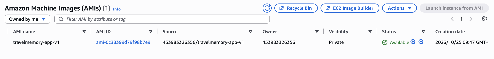

App-02 was launched from that AMI in the same VPC, using the application security group and a public subnet in a different AZ. The final placement is **app-01 in ap-south-1b** and **app-02 in ap-south-1a**, superseding the initial same-AZ attempt.

Its public outbound IP was allowed in Atlas. Both services were active and these requests returned HTTP 200:

```bash
systemctl is-active travelmemory-backend nginx
curl -i --max-time 15 http://127.0.0.1/api/hello
curl -i --max-time 15 http://127.0.0.1/api/trip
```

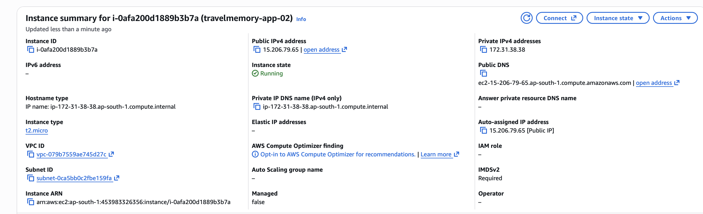

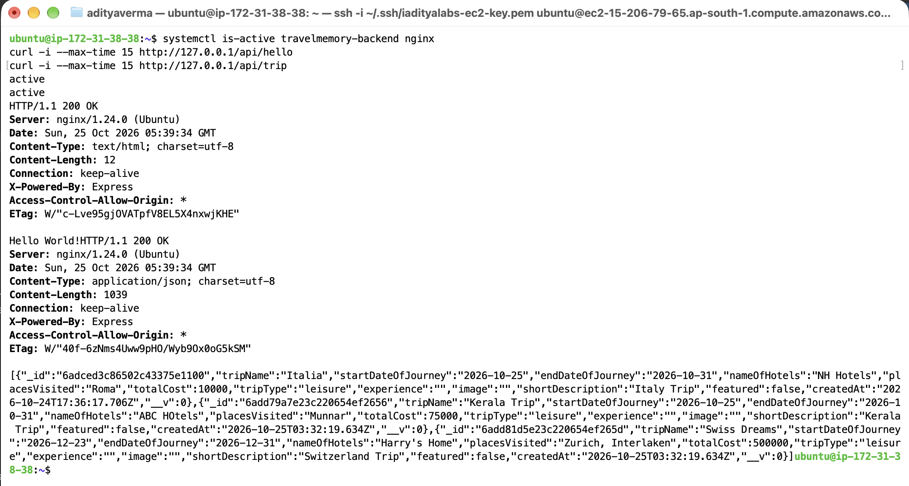

## 11. Configure security groups and the ALB

The load-balancer group is `travelmemory-alb-sg`. The instance security group accepts HTTP on port 80 from the ALB group (`sg-0bce979e86eb50172`), in addition to the operator's direct /32 rule.

| Component | Access used by the deployment |
| --- | --- |
| ALB | Public HTTP:80 and HTTPS:443 |
| Nginx | HTTP:80 from ALB security group; direct HTTP from operator /32 |
| SSH | TCP/22 from operator /32 |
| Express | Port 3000 accessed locally through Nginx; no public ingress rule |
| Atlas | Individual application public outbound IP /32 entries |

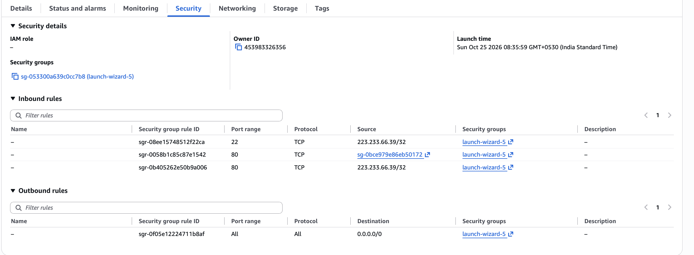

Target group `travelmemory-app-tg` uses Instance targets, HTTP:80 and HTTP/1.1. The deployment procedure specifies health-check path `/api/hello` and success code 200; a dedicated Health checks tab screenshot has not been supplied.

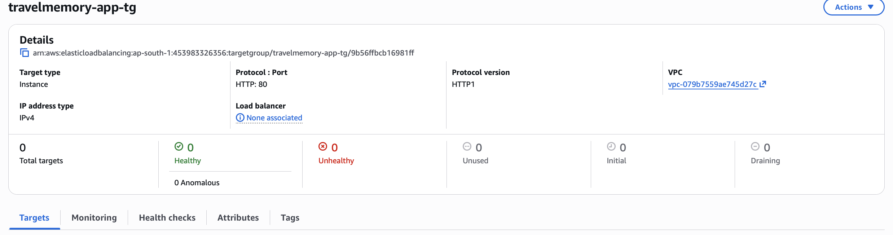

Both instances were registered on port 80. The ALB was configured as Internet-facing and IPv4, with public subnets in **ap-south-1a and ap-south-1b**, and `travelmemory-alb-sg`. The initial HTTP:80 listener forwarded to the target group.

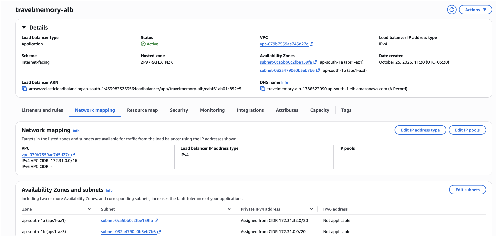

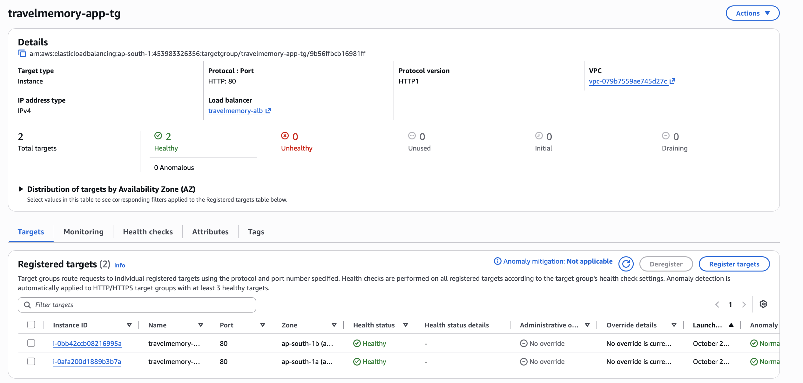

The application was accessible through the ALB DNS name. Reference: [AWS ALB setup](https://docs.aws.amazon.com/elasticloadbalancing/latest/application/create-application-load-balancer.html).

## 12. Configure Cloudflare DNS

These records were added with Auto TTL, preserving unrelated apex and www records:

| Type | Name | Target in the screenshot | Proxy status |
| --- | --- | --- | --- |
| CNAME | `travel` | `travelmemory-alb-1786523090.ap-south-1.elb.amazonaws.com` | DNS only |
| A | `direct` | `3.110.117.89` | DNS only |

The CNAME provides load-balanced access. The A record meets the assignment's direct frontend mapping requirement; confirm it still matches app-01's current public IP. A matching current EC2 overview was not supplied with the DNS capture. Direct access remains restricted by the instance security group.

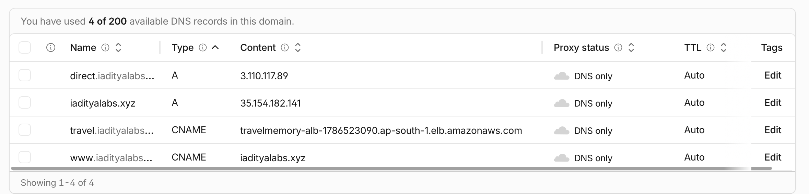

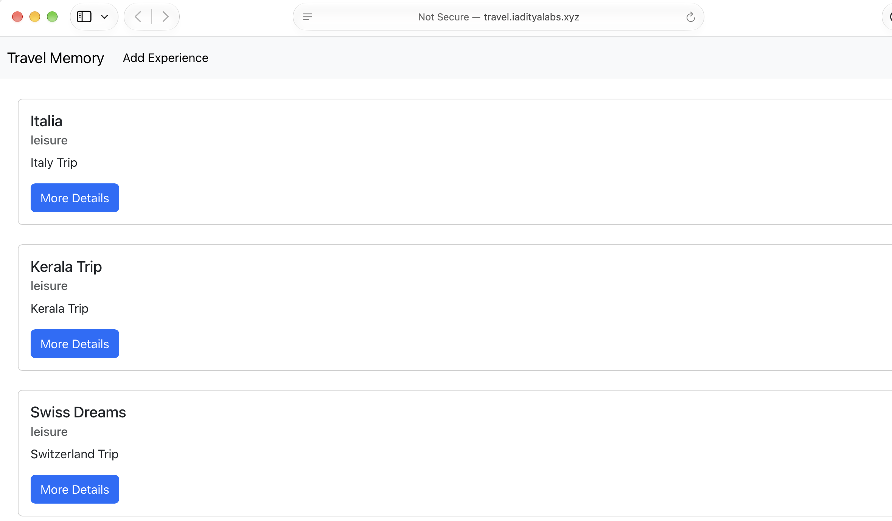

## 13. Enable HTTPS with ACM

A public certificate for `travel.iadityalabs.xyz` was requested in **ap-south-1**, using DNS validation, RSA 2048, and export disabled. The validation CNAME was added to Cloudflare as **DNS only**. ACM issued the certificate. Keep the validation CNAME for renewal. Reference: [ACM DNS validation](https://docs.aws.amazon.com/acm/latest/userguide/dns-validation.html).

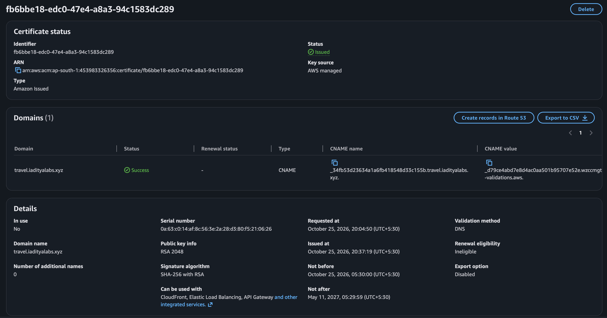

This capture predates listener attachment: its `In use: No` and renewal eligibility reflect that stage. The later listener screenshot shows the certificate attached.


An HTTPS:443 listener forwards to the target group with the issued certificate. The ALB security group requires TCP/443 ingress; a screenshot of its final rules has not been supplied. TLS terminates at the ALB and traffic to Nginx remains HTTP.

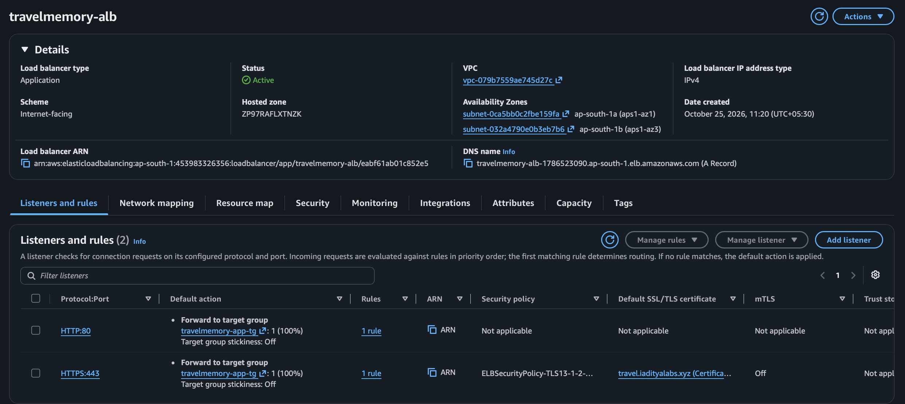

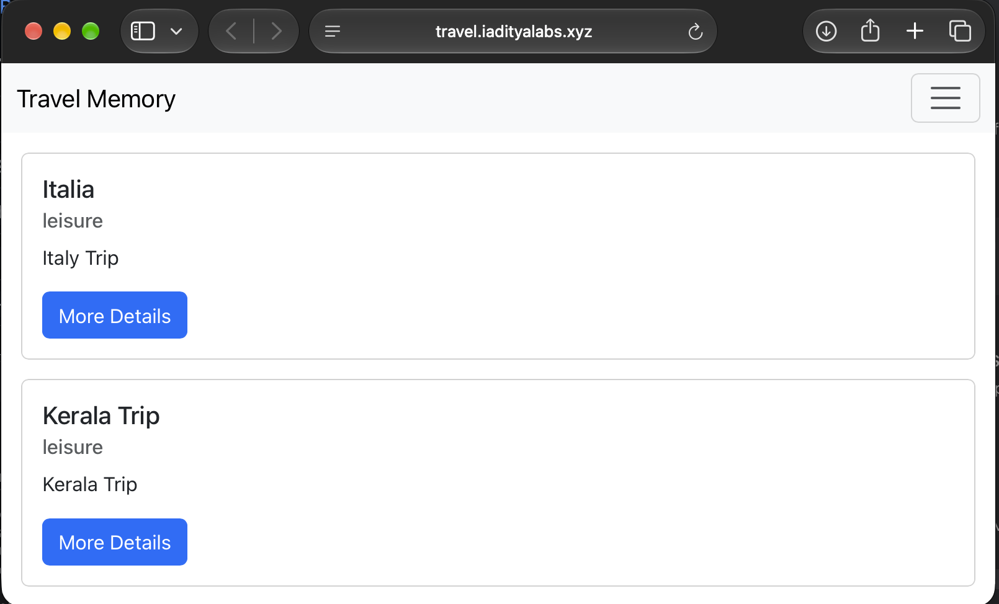

The browser hides the URL scheme. An expanded URL/certificate-details screenshot or successful HTTPS curl transcript would strengthen this evidence. The listener capture shows **HTTP:80 still forwarding**, so HTTP-to-HTTPS redirection has not been demonstrated. Reference: [AWS HTTPS listener setup](https://docs.aws.amazon.com/elasticloadbalancing/latest/application/create-https-listener.html).

## 14. Validation and remaining limits

| Check | Recorded result |
| --- | --- |
| Direct backend on port 3000 | HTTP 200 |
| Database reads | Persisted JSON records returned |
| Backend process management | Enabled and active systemd service |
| React production build | Passed with warnings |
| Nginx syntax and API proxy | Passed |
| Browser trip creation | User confirmation and persisted-record evidence |
| Second-instance services and database access | Passed |
| Two-AZ ALB target health | Two Healthy targets |
| ALB and custom-domain HTTP | Working |
| ACM certificate | Issued |
| ALB HTTPS listener | Configured and attached to certificate |
| Custom-domain HTTPS | Browser screenshot supplied; explicit TLS curl transcript not recorded |
| HTTP-to-HTTPS redirect | Not configured in supplied listener evidence |
| One-instance shutdown test | User confirmed successful service after an initial period of intermittent 504s; elapsed time not measured and two-target recovery not yet recorded |

Installation audits reported **19 backend vulnerabilities** (3 low, 2 moderate, 12 high, 2 critical) and **103 frontend vulnerabilities** (14 low, 46 moderate, 38 high, 5 critical). The frontend also reported dependency deprecations, a Babel dependency warning, an outdated Browserslist dataset, and lint warnings. These did not block deployment; remediation has not been performed. Audit counts alone do not establish production exploitability.

Two healthy targets demonstrate readiness; they do not prove an observed failover or that a particular set of requests reached both instances. Atlas availability is separate from the EC2 multi-AZ arrangement.

## 15. Operations

On either EC2 instance:

```bash
systemctl is-active travelmemory-backend nginx
sudo systemctl status travelmemory-backend --no-pager
sudo nginx -t
curl -i --max-time 15 http://127.0.0.1/api/trip
sudo journalctl -u travelmemory-backend -n 30 --no-pager
```

After frontend changes, rebuild and copy the output on **both** instances, or roll out an updated AMI:

```bash
cd ~/TravelMemory/frontend
GENERATE_SOURCEMAP=false npm run build &&
sudo cp -r build/. /var/www/travelmemory/
```

After stopping and starting instances, update Atlas entries, SSH addresses, and the direct A record for changed public IPs. Enabled services start on boot; wait for ALB target recovery. The main CNAME remains unchanged while the ALB is retained. See [AWS stop/start behavior](https://docs.aws.amazon.com/AWSEC2/latest/UserGuide/how-ec2-instance-stop-start-works.html).

The non-exportable ACM public certificate used with the ALB has no additional certificate charge. EC2, ALB, EBS and snapshot usage have their own charges. Stopping EC2 does not stop ALB or storage billing. See [ACM pricing](https://aws.amazon.com/certificate-manager/pricing/) and [ALB pricing](https://aws.amazon.com/elasticloadbalancing/pricing/).

## 16. Final review and submission

- [x] Deploy frontend, backend, database connection, Nginx, and persistent service.
- [x] Run two healthy application instances across two Availability Zones.
- [x] Configure Cloudflare application CNAME and direct A record.
- [x] Issue and attach the ACM certificate; retain final browser evidence.
- [x] Prepare this report, screenshot index, and editable architecture diagram.
- [ ] Confirm the direct A record matches app-01's current IP.
- [ ] Record an explicit HTTPS check without bypassing certificate validation.
- [ ] Configure and verify HTTP-to-HTTPS redirection if HTTPS enforcement is desired.
- [x] Observe application availability on the surviving instance after the initial failover detection period (user confirmed; transient 504s occurred).
- [ ] Restore the stopped instance and verify both targets return to Healthy; capture failure/recovery evidence and timing if required.
- [x] Retain the original frontend and backend source; deployment uses environment and infrastructure configuration.
- [ ] Confirm rotation of the Atlas password exposed during troubleshooting.
- [ ] Include `docs/` and `deploy/` in the GitHub submission, commit, push, and verify rendered images.
- [ ] Submit the repository link through Vlearn in the permitted text/Word/PDF format.

The documentation and deployment directories are included inside the `TravelMemory/` Git checkout as `docs/` and `deploy/`. Stage them alongside the application changes before committing. See [submission-checklist.md](submission-checklist.md). This draft does not claim an unperformed push, redirect, or successful failover result.


## 17. Follow-up: intermittent 504 during one-instance shutdown

The user reported shutting down one VM and initially observing both successful website loads and HTTP 504 responses. The user then confirmed the application served successfully after waiting, without any configuration changes. This is consistent with health-check convergence and demonstrates eventual availability on the surviving instance; it does not demonstrate zero-downtime failover. The stopped instance identity, detection duration, failing request path, response source, and target health during the transition were not captured. Restoration of both targets has not yet been confirmed.

For a repeatable follow-up test, inspect the target group's Targets tab: the stopped instance should leave Healthy status, while the remaining instance must remain Healthy. Verify Health checks uses HTTP, traffic port 80, path `/api/hello`, and success code 200; record the interval and unhealthy threshold to understand the detection window. Check Attributes: cross-zone load balancing should be On or inherit the ALB's enabled setting. If failures continue after health has converged, capture the failing URL, HTTP status/headers, and test `/api/trip` locally on the surviving instance. A passing `/api/hello` does not establish database readiness. Do not alter timeouts simply to hide the error.

References: [ALB health checks](https://docs.aws.amazon.com/elasticloadbalancing/latest/application/target-group-health-checks.html), [cross-zone routing](https://docs.aws.amazon.com/elasticloadbalancing/latest/application/edit-target-group-attributes.html), [ALB troubleshooting](https://docs.aws.amazon.com/elasticloadbalancing/latest/application/load-balancer-troubleshooting.html).
